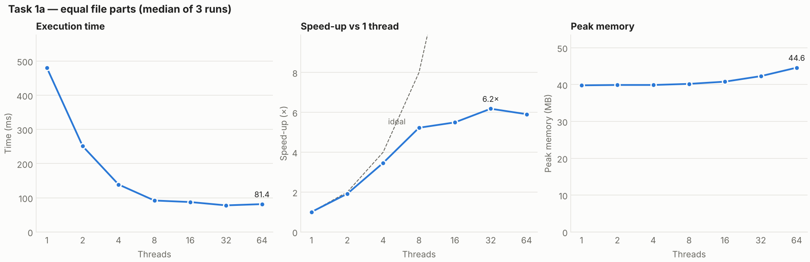
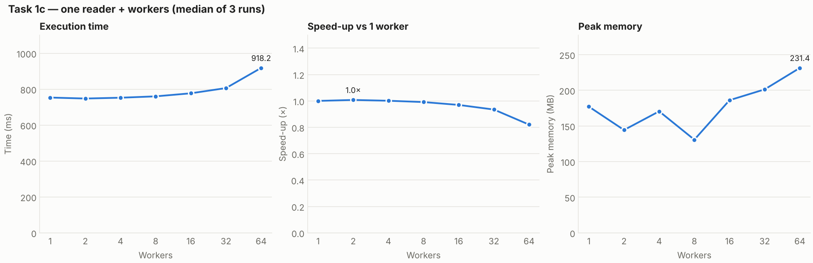
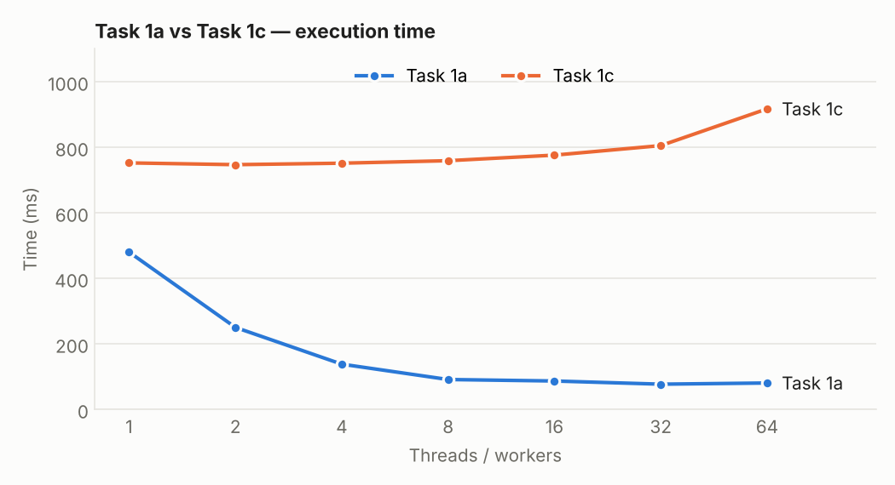

# Tasks 1a and 1c — File partitioning and producer–consumer queue

The input is the generated `numbers.txt` (50,000,000 numbers), read from the
internal SSD of the MacBook described below. The program was built in Release
mode and every configuration was run **3 times**; the tables show the median.
Raw results: [task1a-measurements.csv](../results/task1a-measurements.csv),
[task1c-measurements.csv](../results/task1c-measurements.csv).

**Correctness.** The reference totals from `verify` are 25,005,087 negative,
24,994,889 positive and 24 zero (total 50,000,000). All 42 runs of Task 1a and
Task 1c returned exactly these totals.

## Task 1a — Equal file parts

The file is divided into as many byte ranges as there are threads. Each thread
opens the file, reads only its own range, parses the numbers and counts them
with its own counters. A line that crosses a boundary belongs to the thread
whose range contains the first character of the line: a thread skips the
partial line at the start of its range and finishes the last line of its range,
even past the end. The main thread joins all threads and adds their counts.

| Threads | Time (ms) | Speed-up | Peak memory (MB) |
|---:|---:|---:|---:|
| 1 | 480.9 | 1.00× | 39.8 |
| 2 | 251.1 | 1.92× | 39.9 |
| 4 | 138.9 | 3.46× | 39.9 |
| 8 | 92.0 | 5.23× | 40.2 |
| 16 | 87.5 | 5.50× | 40.8 |
| 32 | 77.8 | 6.18× | 42.3 |
| 64 | 81.4 | 5.91× | 44.6 |

## Task 1c — Producer and consumers

One reader thread reads the file line by line and puts the lines, in batches of
10,000, into a `BlockingCollection<string[]>` with a capacity of 100 batches.
When the queue is full, the reader waits; when it is empty, the workers wait.
At the end of the file the reader calls `CompleteAdding()`, and each worker
stops when the queue is closed and empty.

| Workers | Time (ms) | Speed-up | Peak memory (MB) |
|---:|---:|---:|---:|
| 1 | 753.2 | 1.00× | 177.1 |
| 2 | 747.8 | 1.01× | 144.3 |
| 4 | 752.3 | 1.00× | 170.5 |
| 8 | 759.9 | 0.99× | 130.7 |
| 16 | 776.9 | 0.97× | 186.1 |
| 32 | 806.0 | 0.93× | 201.3 |
| 64 | 918.2 | 0.82× | 231.4 |

Speed-up is the time with 1 thread (or 1 worker) divided by the time with N.

## Answers

**1. At which number of threads does the speed-up stop growing?**
At about 8 threads. From 1 to 8 threads the time falls from 481 ms to 92 ms
(5.2×); after that the speed-up only grows to 5.5× at 16 and 6.2× at 32. This
matches the 10 cores of the Apple M4. Apple Silicon has no
hyper-threading, so the number of logical processors equals the number of
physical cores: there are no extra hardware threads to gain from beyond that.
The speed-up stays below the ideal 8× because the threads also share memory
bandwidth and the disk, and because starting threads and joining them costs time.

**2. Why do 32 and 64 threads not help? Are they slower, and why?**
There are no more cores to run them, so the extra threads only take turns on the
same cores. They are not clearly slower on this machine: 32 threads (77.8 ms)
are even a little faster than 8 (92.0 ms). The likely reason is that the CPU has
fast performance cores and slower efficiency cores. With 8 equal parts, the
threads on the slow cores finish last and everyone waits for them. With many
small parts, the operating system can keep moving work to the fast cores, so the
load is better balanced. At 64 threads the time grows again (81.4 ms), because
the cost of creating and switching between threads outweighs this benefit.

**3. Does the peak memory depend on the number of threads? Why?**
In Task 1a only slightly: from 39.8 MB to 44.6 MB. The file is never loaded
into memory; each thread only has a 64 KB read buffer and its own stack, so
every extra thread adds very little. Most of the 40 MB is the .NET runtime
itself. In Task 1c the memory is much higher (130–230 MB), because up to 100
batches of 10,000 strings wait in the queue, and every line is a separate string
object. It grows with more workers because each worker also holds the batch it
is counting. The values jump between runs (93–195 MB for the same configuration)
because the .NET garbage collector frees unused strings at unpredictable times.

**5. Compare Task 1c with Task 1a. Which one is faster, and why? At which
number of workers does Task 1c stop getting faster?**
Task 1a is much faster: 81 ms against 753 ms at best, and even 1a with one
thread (481 ms) beats 1c with any number of workers. In Task 1c a single
reader thread has to read every line and create a string for it, and this alone
takes about 750 ms. Counting is cheap, so one worker already keeps up with the
reader, and the other workers just wait for batches. Task 1c therefore stops
getting faster at **1 worker** — the time stays at about 750 ms up to 8 workers
and then grows (918 ms at 64), because more threads compete for the same queue
and the system spends time waking threads that have nothing to do. In Task 1a
the reading and the parsing are both divided among the threads.

**6. What would happen with batches of a single line? And with a queue that
has no size limit?**
With one-line batches, each of the 50,000,000 numbers would go through the queue
separately, with a lock and possibly a wake-up of a waiting thread every time.
The queue overhead would be much larger than the counting work, so it would be
far slower. With no size limit, nothing would stop the reader: it would fill the
queue faster than the workers empty it, so memory would keep growing, in the
worst case up to the whole file held as strings. The limit of 100 batches makes
the reader wait (back-pressure) and keeps memory bounded.

## Machine

- Computer: Mac with Apple M4
- CPU: Apple M4 - 10 cores (4 performance + 6 efficiency), no hyper-threading
- Cores: 10 physical / 10 logical
- RAM: 24 GB
- Disk: internal SSD
- OS: macOS 26.6.2
- Runtime: .NET 9 (SDK 9.0.109)
